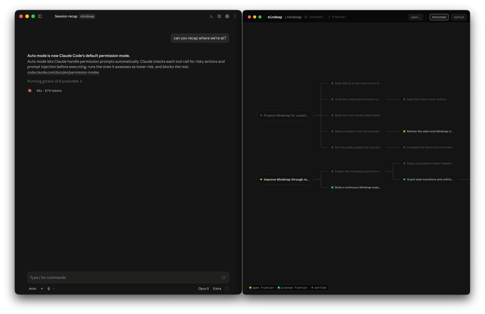
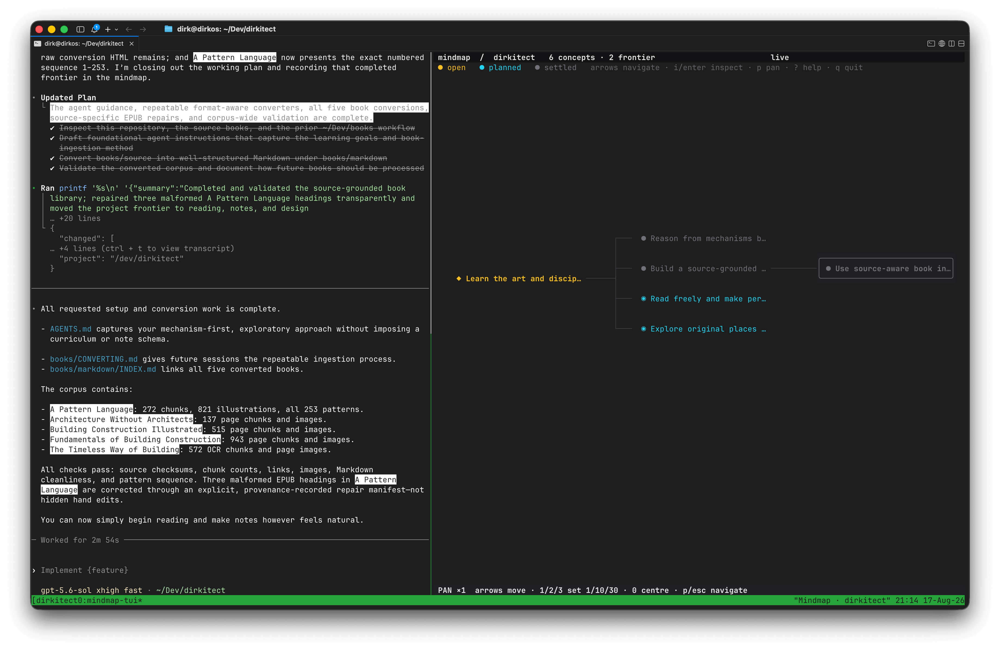

# Mindmap

Mindmap keeps local causal maps of project goals, decisions, open questions, and next steps. The standalone terminal viewer, macOS app, and manual Python CLI remain available.

**Automatic agent integration is paused as of 1 November 2026.** Mindmap is not currently in use by its owner. Automatic transcript capture, context injection, lifecycle hooks, plugin packaging, and dedicated marketplaces have been removed from the current build. Setup and refresh cannot install an integration. Existing maps and transcripts are retained.

Reuse requires changes and a review of instruction quality and unwanted context injection, followed by an explicit decision about installation scope. Re-enabling and publishing are separate decisions. See [the pause and review boundary](docs/integration-paused.md).

Mindmap stores its data on your machine and opens no network listener or remote service of its own.

### Desktop



### TUI



Each node is a meaningful concept, not a message or activity-log entry:

- `planned` - explicitly intended, but not started
- `open` - active work, an unresolved question, or a thread worth resuming
- `settled` - completed work or a resolved decision

## Build and use locally

Previously published installers and binaries do not acquire this pause automatically. Build from this checkout to use the paused version:

```sh
make mindmap
make package
build/mindmap projects
build/mindmap --root /path/to/project
```

`make mindmap` builds the Go terminal viewer and CLI. `make package` generates `packages/mindmap` and `dist/mindmap-cli-VERSION.zip`, containing the standalone Python CLI. Python 3.10+ is required for that package; use `packages/mindmap/bin/mindmap --help` to see its manual commands. No plugin, skill, hook registration, or marketplace is packaged.

The maintained shell and PowerShell installers install only a terminal binary. The shell installer no longer runs setup, including when it downloads an older release. An older binary still contains its old setup behavior; do not use it to configure agents during the pause.

The macOS desktop app still views and edits stored maps. Build it on macOS with `./scripts/build_macos_app.sh`.

## Manual maps

The standalone Python CLI retains `start`, `attach`, `transcript`, `record`, `context`, `status`, `snapshot`, and `stop`. These are explicit local operations. `attach` and `transcript` can import a named transcript; `context` prints text only when requested. No agent session receives that text automatically.

`start` sets the existing project activation flag for manual records. It does not attach an agent, start capture, or install anything. The terminal and desktop viewers read the same database as the Python CLI.

`mindmap setup`, including `--all`, `--source`, and `--refresh`, exits with a pause error before inspecting agents or writing configuration. `mindmap integrations` remains a read-only diagnostic for old installations. `mindmap doctor` checks standalone components without recommending agent installation.

After uninstalling an old plugin, finish or save each affected session and start a fresh client process to clear cached hooks. Do not remove its maps or transcripts. See [compatibility and restart guidance](docs/compatibility.md).

## Terminal controls

Run `mindmap` with no command to open the live terminal view. Press <kbd>?</kbd> for the complete in-app reference.

| Key | Action |
|---|---|
| Arrow keys | Move through parents, children, and visual neighbours |
| <kbd>Enter</kbd> or <kbd>i</kbd> | Open the selected concept |
| <kbd>d</kbd> or <kbd>Delete</kbd> | Confirm and delete the selected branch |
| <kbd>p</kbd> | Toggle pan mode |
| <kbd>1</kbd>, <kbd>2</kbd>, <kbd>3</kbd> | Set the pan step to 1, 10, or 30 characters |
| <kbd>0</kbd> | Centre the selected concept |
| <kbd>?</kbd> | Show keyboard help |
| <kbd>q</kbd> or <kbd>Ctrl-C</kbd> | Quit |

Mindmap detects limited terminals and `NO_COLOR`. Override detection per run with `--color none` or `--ascii always`, or save it:

```sh
mindmap config --color none --ascii always
```

## Command line

`mindmap --help` lists the complete interface. Useful commands include:

```sh
mindmap                         # terminal viewer for the current project
mindmap --root ~/Dev/example    # view a project from elsewhere
mindmap projects                # list local maps
mindmap status                  # show a compact summary
mindmap snapshot                # export the current map as JSON
mindmap open                    # open the current project on macOS
mindmap delete CONCEPT_ID       # confirm, then delete a branch
mindmap stop                    # clear the activation flag; retain the map
```

Deleting a node also deletes every descendant from the current map. The desktop app and terminal viewer both ask for confirmation. Mindmap remembers those user-deleted ids so retained transcript evidence cannot recreate the branch unless the user explicitly asks to restore it. Provenance events and imported transcript evidence remain in SQLite, so deletion is not secure erasure.

## Local data and privacy

SQLite is the source of truth because Mindmap needs atomic checkpoints, safe concurrent agent writes, transcript cursors, retry idempotency, and revision checks. A directory of loose files cannot provide those guarantees without rebuilding a database protocol.

The database defaults to:

```text
${XDG_DATA_HOME:-~/.local/share}/mindmap/mindmap.sqlite3
```

Automatic transcript reading is paused. Existing normalized user and assistant text remains private reconstruction evidence, and the manual Python CLI can import a transcript explicitly. Neither viewer exposes a transcript reader. There is no Mindmap service.

Treat the database as sensitive. Back it up only when no writers are active, or use SQLite's backup tools. Do not place the live database or its WAL files in a file-sync folder.

## Build and contribute

Requirements for a full checkout build are Python 3.10+, Go 1.25.13+, and Node.js 24+.

```sh
npm ci --prefix desktop/frontend
make validate
```

`make mindmap` builds the current terminal binary. `./scripts/build_tui.sh linux/amd64 darwin/arm64 windows/amd64` cross-compiles selected terminal targets. A universal desktop build must run on macOS:

```sh
./scripts/build_macos_app.sh
```

The desktop layer pins Wails v3 beta 8 because native multi-window support is a v3 feature. The release workflow builds, signs, notarizes, and staples the macOS app before publishing it.

Read [CONTRIBUTING.md](CONTRIBUTING.md), [the architecture notes](docs/architecture.md), and [the functional test runbook](docs/functional-test.md) before changing the storage contract. Maintainers can follow [the release guide](docs/releasing.md). Security reports belong in [SECURITY.md](SECURITY.md).

Mindmap is available under the [MIT License](LICENSE).
